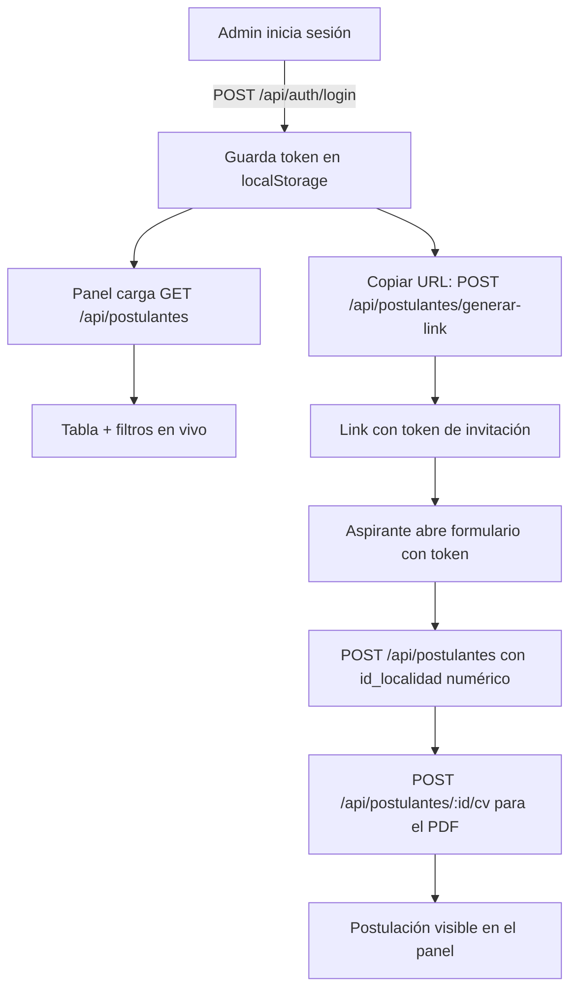

# Documentación de cambios — Formulario de Aspirantes UNPilar

> Repositorio: `candelariarg/formulario-aspirantes-unpi` (frontend React / Create React App)
> Backend asociado: `usina-backend-rrhh` (Express + Prisma + PostgreSQL) corriendo en `http://localhost:3001`
> Frontend: `http://localhost:3000`

Este documento explica **qué se cambió**, **por qué** y **cómo funciona ahora** cada parte, en el orden en que se fueron resolviendo los problemas reportados.

---

## 1. Índice de cambios

| # | Problema / pedido | Archivos involucrados |
|---|---|---|
| 1 | Error "Falló el envío de datos" al enviar el formulario | `Base.jsx`, `Residencia_del_usuario.jsx` |
| 2 | Usar la API externa (georef) en vez de la interna | *(se descartó, se mantuvo la API interna)* |
| 3 | Limpiar warnings de compilación | `Residencia_del_usuario.jsx` |
| 4 | Crear apartado para copiar el link | `Url_copiar.jsx` |
| 5 | "Faltan campos obligatorios" pese a completar todo (CABA) | `Residencia_del_usuario.jsx`, `Validar.js` |
| 6 | "En comuna y barrio no aparece nada" | *(no era bug, ver sección 6)* |
| 7 | Mostrar postulaciones reales en el panel admin | `Panel_principal.jsx`, `Tabla_aspirantes.jsx` |
| 8 | Ajustar el tamaño del span del buscador | `Busqueda_panel.jsx` |
| 9 | Hacer que los filtros funcionen de verdad | `Barra_filtros.jsx`, `Panel_principal.jsx` |

---

## 2. Contexto técnico (para entender los "por qué")

El backend tiene su **propio catálogo de localidades** con IDs numéricos autoincrementales:

- `GET /api/municipios` → `{ id, nombre }` (150 municipios, Pilar = id 113)
- `GET /api/localidades?id_municipio=<id>` → `{ id, nombre, municipio }` (Del Viso = id 254)

Además, la base **sí tiene datos de CABA**, aunque el formulario original no los mostraba:

- 15 Comunas con nombres `"Comuna 1"` … `"Comuna 15"` (ids 31–45)
- 49 barrios en total (ej. Comuna 6 → Caballito, id 865)

El POST `/api/postulantes` valida que `id_localidad` sea un **número entero** (su propia PK). Si llega un `0`, un string o un ID de otro sistema, responde `400 "Faltan campos obligatorios en el formulario"`.

---

## 3. Cambio 1 — Error "Falló el envío de datos"

**Problema**

El frontend usaba la API pública `apis.datos.gob.ar/georef` para cargar municipios/localidades y enviaba el **nombre** (o un ID de georef) en lugar del ID numérico que el backend espera. Los IDs de georef (ej. `0602801008`) no coinciden con los de la base del backend.

**Qué se hizo**

- En `Residencia_del_usuario.jsx` se reemplazó la fuente de datos de georef por la API interna del backend (`/api/municipios` y `/api/localidades`).
- Ahora se guarda el **ID numérico** en `user.municipio` y `user.localidad`.
- En `Base.jsx` se envía `id_localidad: Number(user.localidad)` y se agregó:
  - Validación de presencia del `token` de invitación.
  - Mejora en el manejo de errores para mostrar el mensaje real que devuelve el backend (antes mostraba un error genérico).

**Resultado**

El envío deja de fallar por IDs incompatibles y el usuario ve mensajes de error claros.

---

## 4. Cambio 2 — ¿API externa o interna? (decisión)

**Planteo**

Se evaluó seguir usando georef en lugar de la API interna.

**Conclusión (se mantuvo la API interna)**

1. Los IDs de georef no coinciden con los IDs del backend → rompía el envío.
2. Los barrios de CABA no están en el endpoint `localidades` de georef.
3. El endpoint de CABA de georef daba timeout desde la red del usuario.

Se decidió, con confirmación del usuario, mantener la API interna del backend como única fuente de verdad.

---

## 5. Cambio 3 — Limpieza de warnings

- Se eliminó la variable `nuevaResidencia` que no se usaba.
- La variable `mostrarDireccion` se mantiene (reservada para los futuros campos Calle/Altura) con `void mostrarDireccion;` para no generar warning de "variable no usada".

---

## 6. Cambio 4 — Apartado para copiar el link

**Archivo**: `Url_copiar.jsx` (reescrito por completo)

**Qué hace ahora**

1. Llama a `POST /api/postulantes/generar-link` con el token de admin (`Authorization: Bearer <token>` tomado de `localStorage`).
2. Muestra un panel desplegable con el enlace generado.
3. Botón **Copiar** usando `navigator.clipboard` con *fallback* (`document.execCommand("copy")`) para navegadores sin permisos de portapapeles.
4. Estados de carga, error y confirmación ("¡Copiado!").

> **Pendiente / nota importante**: el backend genera el link con el formato `${FRONTEND_URL}/postulacion?token=...`, pero `App.jsx` no tiene ruta `/postulacion` (la navegación actual es por estado interno `vistaActual`). Para que el link copiado abra realmente el formulario hay que agregar ese manejo de ruta (no se implementó aún).

---

## 7. Cambio 5 — "Faltan campos obligatorios" (residentes de CABA)

**Causa raíz**

Para residentes de C.A.B.A el formulario **no mostraba** selectores de localidad (solo se mostraban para PBA). Entonces `id_localidad` se enviaba como `Number("")` = `0`, y el backend devolvía `400 "Faltan campos obligatorios"` aunque el usuario creyera que completó todo.

**Qué se hizo**

En `Residencia_del_usuario.jsx`:

- CABA ahora muestra los selectores **"Comuna \*"** y **"Barrio \*"**.
- Los municipios se filtran según la residencia:
  - CABA → solo las Comunas (regex `/^comuna\s*\d/i`).
  - PBA → el resto (excluyendo Comunas).

En `Validar.js`:

- Se agregó la validación específica: si la residencia es CABA se exige **comuna + barrio** con mensaje propio ("Para C.A.B.A debe seleccionar comuna y barrio.").

---

## 8. Cambio 6 — "En comuna y barrio no aparece nada"

**Diagnóstico**

Se probó con automatización de navegador y los desplegables **sí funcionaban**: al elegir C.A.B.A aparecían las Comunas 1–15, y al elegir "Comuna 6" aparecía "Caballito".

**Conclusión**

Era un problema de **bundle/hot-reload obsoleto** (caché). Se recomendó recargar con `Ctrl+Shift+R`. No requirió cambios de código.

---

## 9. Cambio 7 — Mostrar postulaciones reales en el panel

**Antes**: el panel usaba un array *mock* de 3 aspirantes hardcodeados.

**Ahora**:

`Panel_principal.jsx`:

- `useEffect` que consulta `GET http://localhost:3001/api/postulantes` con `Authorization: Bearer <token>`.
- Manejo de estados: spinner (carga), mensaje de sesión no válida / expirada (401/403), mensaje de "sin postulaciones" o "sin resultados".
- La búsqueda ahora matchea también contra DNI y email.

`Tabla_aspirantes.jsx`:

- Mapeo de campos del backend: `apellido_y_nombre` → columna "nombre", `nivel_academico`, `especialidad`, `estado`.
- Formateo de fecha (`creado_en` ISO) → `dd/mm/yyyy`.
- Colores de estado: Pendiente (amarillo), Revisado (verde), Entrevista Agendada (azul).

**Verificación**: se inició sesión como admin y el panel mostró 13 postulaciones reales de la base.

---

## 10. Cambio 8 — Tamaño del span del buscador

**Problema**

El `span` con el ícono de la lupa medía 150px, ocupando demasiado espacio.

**Causa**

Una regla global en `App.css`:

```css
.input-group-text {
  width: 150px;
  justify-content: center;
}
```

Esa regla (pensada para los campos con ícono del formulario) afectaba a **todos** los `span.input-group-text`, incluido el del buscador del panel.

**Solución**

En `Busqueda_panel.jsx` se agregó la clase `w-auto` (aplica `width: auto !important`) al span, anulando la regla global solo para ese elemento:

```jsx
<span className="input-group-text bg-white border-secondary-subtle text-secondary px-2 w-auto">
```

**Resultado**: el span pasó de 150px a ~32px, dejando el espacio para el input.

---

## 11. Cambio 9 — Filtros funcionales

**Antes**: los selects de filtros no estaban conectados a ningún estado (no hacían nada) y el botón "Aplicar filtros" no tenía lógica.

**Ahora**:

`Barra_filtros.jsx`:

- Los 4 selects (Especialidad, Nivel de Titulación, Exp. Docente, Estado) ahora son **controlados** (`value` + `onChange`).
- El botón **"Limpiar"** resetea todos los filtros y la búsqueda.

`Panel_principal.jsx`:

- Se agregaron los estados `especialidad`, `nivel`, `expDocente`, `estado`.
- `aspirantesFiltrados` combina la búsqueda con los 4 filtros:
  - **Especialidad** → coincidencia exacta con `especialidad`.
  - **Nivel** → coincidencia con `nivel_academico`.
  - **Estado** → coincidencia con `estado`.
  - **Exp. Docente** → "Sí" = `Es docente` / `Fue docente`; "No" = `Nunca fue docente` (mapeado contra `situacion_institucional` del backend).
- Mensaje de "sin resultados" distingue "no hay postulaciones" vs "no coinciden con los filtros".

**Verificación** (contra las 13 postulaciones reales):

| Filtro | Resultado |
|---|---|
| Estado = "Revisado" | 4 filas ✓ |
| Exp. Docente = "No" | 6 filas ✓ |
| Exp. Docente = "Sí" | 7 filas ✓ (complemento exacto) |
| Especialidad = "Tecnologia e Informatica" | 2 filas ✓ |
| Limpiar | vuelve a 13 ✓ |

---

## 12. Cómo funciona el flujo completo hoy



---

## 13. Endpoints del backend utilizados

| Método | Endpoint | Uso |
|---|---|---|
| `GET` | `/api/municipios` | Cargar municipios/comunas |
| `GET` | `/api/localidades?id_municipio=` | Cargar localidades/barrios |
| `POST` | `/api/auth/login` | Login admin → token |
| `GET` | `/api/postulantes` | Listar postulaciones (requiere token) |
| `POST` | `/api/postulantes` | Crear postulación (usa token de invitación) |
| `POST` | `/api/postulantes/:id/cv` | Subir CV (multipart) |
| `POST` | `/api/postulantes/generar-link` | Generar link de invitación (requiere token) |

---

## 14. Cosas pendientes / recomendadas

1. **Ruta `/postulacion?token=...`**: el link generado no abre el formulario porque `App.jsx` no tiene routing. Hay que agregar el manejo (leer el `token` de la URL y renderizar el formulario).
2. **Regla global `.input-group-text` en `App.css`**: conviene scoperla al formulario para que no vuelva a afectar a componentes del panel.
3. **Modal "Detalles del Postulante"**: está vacío; puede conectarse a `GET /api/postulantes/:id` para mostrar los datos reales.
4. **Filtros por query string**: hoy los filtros se aplican en el cliente (sobre los datos ya cargados). Si crece el volumen, conviene pasarlos al backend como query params (el endpoint ya soporta `especialidad`, `nivel_titulacion`, `estado`, `exp_docente`, etc.).
