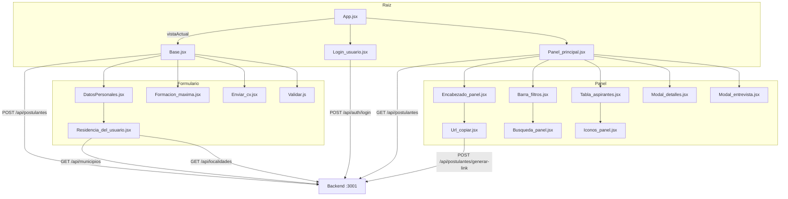

# Documentación del Código — Formulario de Aspirantes UNPilar

> Frontend React (Create React App) — Repositorio `candelariarg/formulario-aspirantes-unpi`
> Backend asociado: `usina-backend-rrhh` (Express + Prisma + PostgreSQL) en `http://localhost:3001`

Este documento explica **cómo está organizado el código**, **qué hace cada archivo** y **cómo se conectan entre sí**. Es un complemento de [DOCUMENTACION_CAMBIOS.md](./DOCUMENTACION_CAMBIOS.md) (que explica el *porqué* de los cambios).

---

## 1. Vista general de la aplicación

La app tiene **dos grandes flujos**:

1. **Formulario del aspirante**: una persona (docente aspirante) completa sus datos personales, académicos y sube su CV. Se envía al backend junto con un *token de invitación*.
2. **Panel de administración**: un usuario de RRHH inicia sesión, ve la lista de postulaciones reales, las filtra, copia el link de invitación y gestiona a los aspirantes.

**Stack / tecnologías:**

| Capa | Tecnología |
|---|---|
| UI | React 19 (con JSX) |
| Build | Create React App (`react-scripts` 5) |
| Estilos | Bootstrap 5 + `react-bootstrap` + CSS propio (`App.css`) |
| Multiselect | `react-select` |
| Estado | Hooks de React (`useState`, `useEffect`) |
| Navegación | Estado local (`vistaActual` en `App.jsx`, **sin react-router**) |
| Datos | API REST del backend en `http://localhost:3001` |

---

## 2. Estructura de carpetas

```
src/
├── index.js                 # Punto de entrada de React
├── App.jsx                  # Componente raíz + navegación por estado
├── App.css                  # Estilos globales (fondo, tarjeta, dropdowns)
├── index.css                # Reset básico de estilos
├── docs/
│   └── data.js              # Catálogo estático de especialidades (react-select)
└── componentes/
    ├── hooks/
    │   └── Hooks.js         # (legacy / sin uso) intento de hook de validación
    ├── validaciones/
    │   └── Validar.js       # Regex y validación de campos del formulario
    ├── formulario/          # Componentes del formulario del aspirante
    │   ├── Base.jsx         # Contenedor + lógica de envío
    │   ├── DatosPersonales.jsx
    │   ├── Formacion_maxima.jsx
    │   ├── Residencia_del_usuario.jsx
    │   └── Enviar_cv.jsx
    └── PanelAdministrador/  # Componentes del panel de RRHH
        ├── Login_usuario.jsx
        ├── Panel_principal.jsx
        ├── Encabezado_panel.jsx
        ├── Barra_filtros.jsx
        ├── Busqueda_panel.jsx
        ├── Tabla_aspirantes.jsx
        ├── Iconos_panel.jsx
        ├── Modal_detalles.jsx
        ├── Modal_entrevista.jsx
        └── Url_copiar.jsx
```

---

## 3. Punto de entrada y raíz

### 3.1 `src/index.js`

```jsx
import React from 'react';
import ReactDOM from 'react-dom/client';
import 'bootstrap/dist/css/bootstrap.min.css';
import App from './App';

const root = ReactDOM.createRoot(document.getElementById('root'));
root.render(
  <React.StrictMode>
    <App />
  </React.StrictMode>
);
```

- Monta la app en el `<div id="root">` de [public/index.html](./public/index.html).
- Importa el CSS de **Bootstrap** (por eso todas las clases `btn`, `form-control`, `row`, etc. funcionan).
- `React.StrictMode` ayuda a detectar errores en desarrollo (ejecuta renderizados dobles).

### 3.2 `src/App.jsx`

```jsx
function App() {
  const [vistaActual, setVistaActual] = useState("login");

  const manejarLoginExitoso = () => {
    setVistaActual("panel");
  };
  ...
}
```

**Qué hace:**

- Controla qué "pantalla" se muestra mediante el estado `vistaActual`, que puede ser `"formulario"`, `"login"` o `"panel"`.
- `manejarLoginExitoso` cambia la vista a `"panel"` cuando el login es exitoso.
- Renderiza un **menú de navegación de desarrollo** (fijo abajo) con 3 botones para saltar entre pantallas, útil mientras no haya routing real.

> ⚠️ **Importante**: como no usa `react-router`, el link generado con formato `/postulacion?token=...` aún no dispara la apertura del formulario. Es una de las tareas pendientes (ver sección final).

---

## 4. Formulario del aspirante

### 4.1 `componentes/formulario/Base.jsx` — contenedor principal

Es el corazón del formulario. Responsabilidades:

**a) Estado del formulario (`useState`)**

```jsx
const [user, setUser] = useState({
  nombre: '', apellido: '', dni: '', fechaNacimiento: "",
  telefono: '', correo: '', residencia: '', municipio: '',
  localidad: '', calle: '', altura: '', especialidades: [],
  formacion: '', otrasFormaciones: '', linkedin: '',
  experienciaDocencia: false, cv: null
});
```

Un único objeto `user` concentra **todos** los datos del aspirante.

**b) Manejo de cambios (`handleUsernameInput`)**

```jsx
const handleUsernameInput = (e) => {
  const { name, value, type, checked, files } = e.target;
  ...
};
```

- Extrae `name` (identificador del campo) y `value` del evento.
- Soporta **checkboxes** (`checked`), **archivos** (`files`) y campos de texto normales.
- Para `dni` y `telefono` filtra solo dígitos (`.replace(/\D/g, "")`).
- Actualiza el estado con `setUser(prev => ({ ...prev, [name]: valorFinal }))`.

**c) Envío del formulario (`handleSumbitForm`)**

Flujo:

1. Valida con `validarFormulario(user)` (de `Validar.js`). Si hay errores, muestra un `alert` con la lista y corta.
2. Calcula la situación institucional: `experienciaDocencia ? 1 : 3` (1 = "Es docente", 3 = "Nunca fue docente").
3. Convierte las especialidades a IDs numéricos (`Number(esp.value)`); si tiene experiencia docente agrega el tag `10`.
4. Lee el **token de invitación** de la URL (`new URLSearchParams(window.location.search).get("token")`). Sin token, avisa y corta.
5. Arma el `payload` y hace `POST http://localhost:3001/api/postulantes`.
6. Si el POST responde con error, intenta leer el mensaje del backend (`data.error`) y lo muestra.
7. Con el `postulante_id` recibido, sube el CV como `FormData` (multipart) a `POST /api/postulantes/:id/cv`.
8. Alerta de éxito al final.

**d) Render**

Arma la estructura del formulario dentro de una tarjeta (`card`), con el logo y los tres bloques:

```jsx
<DatosPersonales user={user} onChange={handleUsernameInput} />
<FormacionAcademica user={user} onChange={handleUsernameInput} />
<EnviarCV user={user} onChange={handleUsernameInput} />
```

Todos los subcomponentes reciben el mismo `user` y el mismo `onChange` (patrón de "levantar estado").

---

### 4.2 `componentes/formulario/DatosPersonales.jsx`

Renderiza los campos personales básicos usando Bootstrap:

- **Nombre** / **Apellido**: `input type="text"`.
- **DNI** / **Teléfono**: `input` con `inputMode="numeric"` y `pattern="[0-9]*"` (el filtrado real de dígitos lo hace `Base.jsx`).
- **Fecha de nacimiento**: `input type="date"`.
- **Correo electrónico**: `input type="email"`.
- **Perfil de LinkedIn**: campo opcional.
- **Residencia**: delega en el componente `<Residencia />`.
- **Experiencia docente**: `input type="checkbox"` con `name="experienciaDocencia"`.

Cada input usa `name` (ej. `"nombre"`) que coincide con la clave en el objeto `user`, y `value={user?.nombre || ""}` (el `?.` evita errores si `user` es null/undefined). El `onChange` es el mismo para todos.

---

### 4.3 `componentes/formulario/Residencia_del_usuario.jsx`

Es el selector de ubicación más complejo. Usa `react-bootstrap` (`Dropdown`, `Form`).

**Estados locales:**

```jsx
const [municipio, setMunicipio] = useState(null);
const [municipios, setMunicipios] = useState([]);
const [busquedaMunicipio, setBusquedaMunicipio] = useState("");
const [localidad, setLocalidad] = useState(null);
const [localidades, setLocalidades] = useState([]);
const [busquedaLocalidad, setBusquedaLocalidad] = useState("");
```

**`useEffect` 1 — cargar municipios/comunas según residencia:**

- Si `residencia === "CABA"` → filtra solo las **Comunas** (regex `/^comuna\s*\d/i`).
- Si `residencia === "PBA"` → filtra el resto (excluye Comunas).
- Hace `fetch("http://localhost:3001/api/municipios")`.

**`useEffect` 2 — cargar localidades/barrios al elegir municipio:**

- `fetch(\`http://localhost:3001/api/localidades?id_municipio=${municipio.id}\`)`.
- Reinicia `localidad` a null al cambiar de municipio.

**Filtrado por búsqueda** (dentro del dropdown):

```jsx
const municipiosFiltrados = municipios.filter((m) =>
  m.nombre.toLowerCase().includes(busquedaMunicipio.toLowerCase()),
);
```

**Comportamiento clave de la UI:**

- El `select` de Residencia, al cambiar, **limpia** `municipio`, `localidad` y las búsquedas (envía `onChange` con `municipio: ""` y `localidad: ""` al estado padre).
- Al elegir un municipio, guarda `m.id` en `user.municipio` y resetea `localidad`.
- Al elegir una localidad, guarda `l.id` en `user.localidad`.

> **Detalle importante**: se guardan los **IDs numéricos** del backend (no los nombres), porque el POST `/api/postulantes` espera `id_localidad` como entero.

---

### 4.4 `componentes/formulario/Formacion_maxima.jsx`

Componente de "Formación Académica". Contiene:

1. **Especialidades** (multiselección) con `react-select`:

```jsx
<Select
  closeMenuOnSelect={false}
  components={animatedComponents}
  value={user?.especialidades || []}
  isMulti
  options={especialidades}
  onChange={(selectedOptions) => onChange({ target: { name: "especialidades", value: selectedOptions || [] } })}
/>
```

- `isMulti` permite elegir varias especialidades.
- `closeMenuOnSelect={false}` mantiene el menú abierto al seleccionar.
- `animatedComponents` da animaciones.
- Al cambiar, envía el array de opciones elegidas a través del `onChange` padre (simulando un evento con `name: "especialidades"`).

2. **Nivel máximo de titulación**: `select` con opciones Pregrado/Grado/Especialización/Maestría/Doctorado (`name="formacion"`).

3. **Otras Formaciones**: campo de texto opcional (`name="otrasFormaciones"`).

> ⚠️ **Nota**: los `value` del select de titulación usan valores **sin acentos** ("Maestria", "Especializacion") mientras el backend/panel esperan "Maestría", "Especialización". Esto puede causar desajustes en el filtro por nivel (ver pendientes).

---

### 4.5 `componentes/formulario/Enviar_cv.jsx`

Campo para subir el CV:

```jsx
<input type="file" ... name="cv" accept=".pdf,application/pdf" onChange={onChange} required />
```

- `accept=".pdf,application/pdf"` restringe a PDF.
- Cuando `user.cv` existe, muestra un mensaje verde con el nombre del archivo cargado (distingue entre objeto `File` y string).

---

### 4.6 `componentes/validaciones/Validar.js`

Contiene las reglas de validación.

**Regex exportadas:**

```js
export const regexEmail = /^[^\s@]+@[^\s@]+\.[^\s@]+$/;
export const regexDni = /^\d{7,8}$/;
export const regexTelefono = /^\d{10,15}$/;
```

**`campoCompletado(nombreDelCampo, valor)`**

Usa un `switch` para validar campo por campo:

- `nombre`/`apellido` → string no vacío.
- `dni` → 7 u 8 dígitos.
- `telefono` → 10 a 15 dígitos.
- `correo` → formato email.
- `formacion` → distinto de vacío/null/undefined.
- `residencia` → string no vacío.
- `especialidades` → array no vacío.
- `experienciaDocencia` → booleano.
- `fechaNacimiento` → string no vacío.
- `cv` → no null/undefined/vacío.
- `default` → `true` (campo no validado pasa).

**`validarFormulario(user)`**

Recorre los campos obligatorios y llena un objeto `errores` con mensajes en español. Devuelve:

```js
{ valido: Object.keys(errores).length === 0, errores }
```

Además valida el caso especial de residencia: si es PBA o CABA, exige `municipio` + `localidad` con mensajes distintos según el caso.

---

### 4.7 `docs/data.js` — catálogo de especialidades

```js
export const especialidades = [
  { value: 1, label: 'Humanidades y Ciencias Sociales', color: '#00B8D9', isFixed: true },
  { value: 2, label: 'Tecnologia e Informatica', color: '#0052CC' },
  ...
];
```

- Define las 7 especialidades con su `value` numérico (que coincide con los IDs de tag del backend) y un `label` legible.
- `color` se usa en el multiselect de `react-select`.
- `isFixed` marca opciones fijas (no removibles) en el select.

> Este archivo está en `src/docs/`, no en `componentes/`. Es el origen de datos estático de las especialidades.

---

## 5. Panel de Administración

### 5.1 `componentes/PanelAdministrador/Login_usuario.jsx`

Formulario de login:

- Estado local `credenciales = { email, password }`.
- `handleInputCambio` actualiza el estado.
- `handleSumbitLogin`:
  1. `POST http://localhost:3001/api/auth/login` con las credenciales.
  2. Si falla → `alert("Credenciales incorrectas...")`.
  3. Si responde OK → guarda `data.token` en `localStorage` con clave `"token"`, muestra alerta de éxito y llama a `onLoginExitoso()` (que en `App.jsx` cambia la vista al panel).

> El token guardado es lo que luego usan `Panel_principal.jsx` y `Url_copiar.jsx` para autenticarse contra la API.

---

### 5.2 `componentes/PanelAdministrador/Panel_principal.jsx` — contenedor del panel

Es el contenedor principal del panel. Contiene:

**Estados:**

```jsx
const [modalDetalles, setModalDetalles] = useState(false);
const [modalEntrevista, setModalEntrevista] = useState(false);
const [busqueda, setBusqueda] = useState("");
const [especialidad, setEspecialidad] = useState("");
const [nivel, setNivel] = useState("");
const [expDocente, setExpDocente] = useState("");
const [estado, setEstado] = useState("");
const [aspirantes, setAspirantes] = useState([]);
const [cargando, setCargando] = useState(true);
const [error, setError] = useState("");
```

**`limpiarFiltros()`**: resetea búsqueda + 4 filtros.

**`useEffect` — cargar postulaciones:**

```jsx
const token = localStorage.getItem("token");
const res = await fetch(API_POSTULANTES, {
  headers: { Authorization: `Bearer ${token}` },
});
```

- Toma el token de `localStorage`.
- Maneja 401/403 (sesión expirada) con mensaje propio.
- Maneja errores HTTP genéricos.
- Guarda el array de postulantes en `aspirantes`.

**`normalizar(texto)`**: quita acentos y pasa a minúsculas, para que la búsqueda sea tolerante a tildes.

**`aspirantesFiltrados`**: filtra `aspirantes` combinando:

1. **Búsqueda por texto** sobre `apellido_y_nombre`, DNI y email (cada palabra debe matchear).
2. **Especialidad** (match exacto).
3. **Nivel** (match sobre `nivel_academico`).
4. **Estado** (match sobre `estado`, con default "Pendiente").
5. **Exp. docente**: "Sí" → `es docente`/`fue docente`; "No" → `nunca fue docente`.

**Render condicional:**

- Si `cargando` → spinner.
- Si `error` → alerta roja.
- Si no hay resultados → mensaje (distingue "sin filtros" vs "sin coincidencias").
- Si hay datos → `<TablaAspirantes />`.

**Constantes de color:** `colorPrimario = "#14589f"` (azul institucional) y `colorAcento = "#0d6efd"`.

---

### 5.3 `componentes/PanelAdministrador/Encabezado_panel.jsx`

Encabezado superior del panel:

- Título "Portal de Aspirantes a Cátedra".
- A la derecha: botón `<CopiarUrlFormulario />`, un icono SVG de usuario y el texto "Admin UNPilar".
- Recibe `colorPrimario` para pintar el borde izquierdo y el título.

---

### 5.4 `componentes/PanelAdministrador/Barra_filtros.jsx`

Barra de filtros. Define tres constantes de opciones:

```js
const ESPECIALIDADES = [...]; // 7 opciones
const NIVELES = ["Grado", "Maestría", "Doctorado"];
const ESTADOS = ["Pendiente", "Revisado", "Entrevista Agendada"];
```

- Recibe los 5 estados de filtro y sus setters + `onLimpiar`.
- Cada `select` es **controlado** (`value` + `onChange`), y actualiza el estado padre directamente.
- Botón **"Limpiar"** que ejecuta `onLimpiar`.

> La búsqueda se delega en `BarraBusquedaPanel`.

---

### 5.5 `componentes/PanelAdministrador/Busqueda_panel.jsx`

Campo de búsqueda con icono de lupa (SVG) dentro de un `input-group`:

- `<span className="input-group-text ... px-2 w-auto">` contiene el SVG de la lupa.
- `input` con placeholder "Apellido o nombre...".
- Si `busqueda` no está vacío, muestra un botón "✕" para limpiarla.

> La clase `w-auto` se agregó para anular la regla global `.input-group-text { width: 150px }` de `App.css` y que el span no ocupe tanto espacio.

---

### 5.6 `componentes/PanelAdministrador/Tabla_aspirantes.jsx`

Renderiza la tabla de postulaciones.

**Funciones helper:**

```js
const formatearFecha = (valor) => {
  // convierte fecha ISO a "dd/mm/yyyy" (es-AR)
};

const estiloEstado = (estado) => {
  // Revisado -> bg-success, Entrevista Agendada -> bg-info, Pendiente -> bg-warning
};
```

**Columnas:**

| Columna | Campo del backend |
|---|---|
| Fecha | `fecha` (formateada con `formatearFecha`) |
| Apellido y Nombre | `apellido_y_nombre` (o fallback `apellido, nombre`) |
| Especialidad | `especialidad` |
| Nivel Académico | `nivel_academico` |
| Estado | `estado` (badge de color) |
| Acciones | `<IconosPanelAdmin />` |

Si `aspirantes.length === 0`, muestra una fila vacía con mensaje.

Cada fila usa `key={a.id}`.

---

### 5.7 `componentes/PanelAdministrador/Iconos_panel.jsx`

Cuatro iconos SVG de acción por fila:

1. **Ojo** (azul) → "Ver Detalles del Perfil" → `onVerDetalles`.
2. **Check** (verde) → "Marcar como Revisado" (sin handler aún).
3. **Calendario** (celeste) → "Agendar Entrevista" → `onAgendarEntrevista`.
4. **Sobre** (gris) → "Enviar Resolución" (sin handler aún).

> Los iconos 2 y 4 están como placeholder (solo título), no tienen `onClick` conectado a lógica real.

---

### 5.8 `componentes/PanelAdministrador/Modal_detalles.jsx`

Modal para ver los detalles de un postulante. Actualmente es un **placeholder**:

- Muestra un texto "Aquí se mostrarán los datos estructurados del formulario y el visor PDF integrado."
- Botón "Descargar CV" sin lógica.

> Pendiente de conectar con `GET /api/postulantes/:id`.

---

### 5.9 `componentes/PanelAdministrador/Modal_entrevista.jsx`

Modal para agendar una entrevista:

- Campos: **Fecha acordada** (`date`), **Horario** (`time`), **Modalidad de contacto** (select: Presencial/Virtual).
- Botones "Cancelar" y "Guardar Entrevista" (ambos solo cierran el modal por ahora, no persisten datos).

---

### 5.10 `componentes/PanelAdministrador/Url_copiar.jsx`

Botón + panel para copiar el link de invitación.

**Estados:** `abierto`, `link`, `cargando`, `copiado`, `error`.

**`generarLink()`**:

```js
const res = await fetch(API_GENERAR_LINK, {
  method: "POST",
  headers: { Authorization: `Bearer ${token}` },
});
```

- `POST http://localhost:3001/api/postulantes/generar-link` con el token admin.
- Guarda `data.link` en el estado.

**`copiarAlPortapapeles()`**:

- Intenta `navigator.clipboard.writeText(link)`.
- Si falla, usa un `input` temporal + `document.execCommand("copy")` como fallback.
- Muestra "¡Copiado!" durante 2 segundos.

**`toggle()`**: abre/cierra el panel; al abrir, si no hay link, llama a `generarLink()`.

**UI**: botón "Copiar URL del Formulario" y un panel desplegable (`position-absolute`) con el link (input readonly + botón Copiar) y la nota "Expira en 48 horas."

---

## 6. Archivos de soporte y estilos

### 6.1 `src/App.css`

Estilos globales:

- **Fondo**: imagen `1-nuevo-edificio.jpeg` con gradiente azul superpuesto (`linear-gradient`).
- **`.App`**: centra el contenido.
- **`.logo`**: ancho 30%.
- **`.input-group-text { width: 150px }`**: ⚠️ regla global que fuerza ancho a todos los `span.input-group-text` (ver sección de cambios / pendientes).
- **`.card`**: tarjeta con `max-width: 750px`, `zoom: 80%`, blur y sombra.
- **`.form-select`**: fondo blanco forzado.
- **Dropdowns**: fondo blanco, hover y active.

### 6.2 `src/index.css`

Reset mínimo: márgenes, fuente base y estilo de `code`.

### 6.3 `public/index.html`

Plantilla HTML base:

- Título "Formulario Docentes Aspirantes UNPi".
- `<div id="root"></div>` donde React monta la app.
- Placeholder para futura fuente de Google (`<link rel="preconnect" href="" />`).

### 6.4 `public/` — assets

- `logo-unpi.png`: logo usado en formulario y login.
- `1-nuevo-edificio.jpeg`: imagen de fondo.

---

## 7. Archivos legado / sin uso

### `src/componentes/hooks/Hooks.js`

```js
import {useState, useEffect} from "react"
import {camposObligatorios} from "../constantes/Constantes"
```

- Importa desde `../constantes/Constantes`, que **no existe** en el proyecto (no hay carpeta `constantes`).
- Es un archivo legacy/incompleto que no está importado por ningún otro archivo. No afecta la app en runtime.

---

## 8. Diagrama de componentes y flujo de datos



---

## 9. Flujo de datos y contratos con el backend

### 9.1 Formulario → POST `/api/postulantes`

`Base.jsx` envía:

```js
{
  token,                    // token de invitación (de la URL)
  nombre, apellido, dni,
  fecha_nacimiento,
  id_localidad: Number(user.localidad),  // ID numérico
  mail_personal, telefono_principal, linkedin,
  nivel_titulacion: user.formacion,
  otras_formaciones,
  id_situacion_institucional: 1 | 3,
  tags: [Number(esp.value), ...]         // IDs de tags
}
```

Respuesta: `{ mensaje, postulante_id }`.

### 9.2 CV → POST `/api/postulantes/:id/cv`

`Base.jsx` envía `FormData` con clave `cv`.

### 9.3 Panel → GET `/api/postulantes`

`Panel_principal.jsx` envía header `Authorization: Bearer <token>`.

Respuesta (array):

```js
{
  id, fecha, nombre, apellido, apellido_y_nombre,
  especialidad, nivel_academico, nivel_titulacion,
  exp_docente, situacion_institucional, localidad, municipio,
  estado, curriculum, dni, mail, telefono, etiquetas, tags
}
```

### 9.4 Login → POST `/api/auth/login`

`Login_usuario.jsx` envía `{ email, password }`; recibe `{ token }`.

### 9.5 Generar link → POST `/api/postulantes/generar-link`

`Url_copiar.jsx` envía header `Authorization: Bearer <token>`; recibe `{ link }`.

---

## 10. Puntos a tener en cuenta / mejoras pendientes

1. **Routing**: `App.jsx` no tiene `react-router`; el link `/postulacion?token=...` no abre el formulario. Falta leer el token de la URL y renderizar `BaseForm`.
2. **Acentos en nivel de titulación**: `Formacion_maxima.jsx` usa "Maestria"/"Especializacion" sin acentos, mientras el panel y el backend usan "Maestría"/"Especialización". Conviene unificar para que el filtro por nivel matchee.
3. **Regla global `.input-group-text`** en `App.css`: conviene scoperla al formulario para no afectar al panel (ya se mitigó con `w-auto` en el buscador).
4. **Modal de detalles**: vacío; conectar con `GET /api/postulantes/:id`.
5. **Acciones de tabla**: "Marcar como Revisado" y "Enviar Resolución" no tienen lógica conectada (el backend expone `PATCH /api/postulantes/:id/estado`).
6. **Filtros por query string**: hoy se filtran en el cliente; el backend ya soporta `especialidad`, `nivel_titulacion`, `estado`, `exp_docente`, etc. para escalar.
7. **`Hooks.js`**: archivo legacy con import roto a `constantes/Constantes`; se puede eliminar.
8. **URLs hardcodeadas**: todas las llamadas usan `http://localhost:3001`; conviene centralizar en una variable de entorno (`process.env.REACT_APP_API_URL`).
